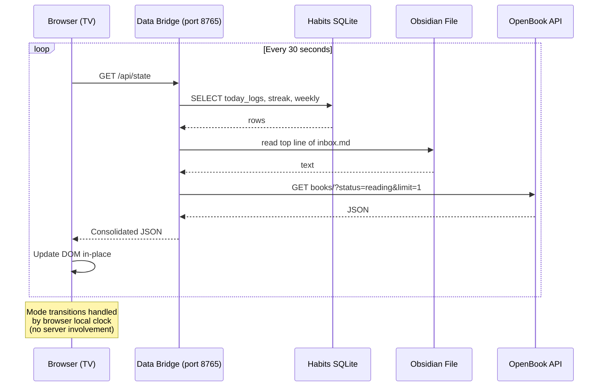

# LifeDash — Content Flow & Behaviour

**Status:** Draft | **Owner:** Javohir | **Last updated:** 2026-07-19

---

## 1. Timelines

### Daily Lifecycle (24h)

```
Fajr (varies)     8:00 AM            8:00 PM       9:00 PM      Fajr
   │                 │                  │             │           │
   ▼                 ▼                  ▼             ▼           ▼
┌────────┐     ┌────────┐        ┌─────────┐   ┌────────┐  ┌────────┐
│MORNING │────▶│  DAY   │────────▶│ EVENING │──▶│ NIGHT  │──▶│MORNING │
│ Plan   │     │ Track  │        │ Reflect │   │ Sleep  │  │  mode  │
└────────┘     └────────┘        └─────────┘   └────────┘  └────────┘
```

### Data Refresh Cycle (within any mode)

```
┌──────────┐    ┌──────────────┐    ┌──────────┐
│ Browser  │───▶│ Data Bridge  │───▶│ Frontend │
│ setInterval│   │ (FastAPI)    │   │ DOM update│
│ every 30s │◀──│              │◀──│ in-place  │
└──────────┘    └──────────────┘    └──────────┘
```

## 2. Screen States

### Loading State
- Shown on first page load only (subsequent updates are in-place)
- Skeleton layout: grey placeholder blocks matching final layout proportions
- Duration: <500ms (data bridge is local)

### Normal State
- Full content as described in UX doc
- Content updates silently every 30 seconds

### Error / Degraded State
- If a data source fails (e.g., OpenBook API down), hide that section entirely
- No error messages on screen — the dashboard should never show "ERROR"
- Remaining sections continue showing live data
- Logged to console only

### Dim / Screen-saver
- After 5 minutes of no detectable occupancy (optional: webcam?), or
- Manually triggered by pressing any key (Chromium intercepts key → dim)
- Fade to dimmed night-mode level

## 3. Content Priority Hierarchy

When the dashboard needs to decide what to show (e.g., small layout or error degradation):

| Priority | Content | Why |
|:--------:|---------|-----|
| **P0** | Clock + date | Core utility — always |
| **P1** | Prayer countdown | Time-sensitive, religious obligation |
| **P2** | Today's habits | Daily tracking, visible progress |
| **P3** | Top todo | Task awareness |
| **P4** | Current book | Nice-to-know |
| **P5** | Today's highlight | Decorative/value-add |

## 4. Data Flow Diagram



## 5. Edge Cases

| Scenario | Behaviour |
|----------|-----------|
| **Laptop sleeps** | Chromium process dies → auto-start on wake via systemd user service |
| **No internet** | Clock + habits + todos still work (all local). OpenBook section hides. |
| **Midnight rollover** | Habits/prayer data switches to new day automatically |
| **Browser crash** | systemd `Restart=always` relaunches Chromium |
| **Fajr time varies** | Mode transition reads actual Fajr time from prayer data (not hardcoded) |
| **Empty todo** | Show "No tasks pending" — positive tone, green |
| **No book being read** | Hide reading section entirely |
| **Habits DB locked** | Retry after 1s, serve stale data if still locked |
| **1080p vs 4K TV** | CSS uses `vw`/`vh` units — scales automatically |

## 6. User Workflow

The user's interaction with the dashboard is intentionally minimal:

```
Wake up → glance at TV → see prayer time + today's habits → proceed with day
                 ↓
Mid-day glance → "3/5 habits done, Asr coming up" → adjust
                 ↓
Evening → highlight catches eye → recalls the day → journal prompt
                 ↓
Night → dim clock, next Fajr → wind down
```

No clicks, no navigation, no configuration UI. If Javohir needs to change something, he edits the config file on the homelab.
