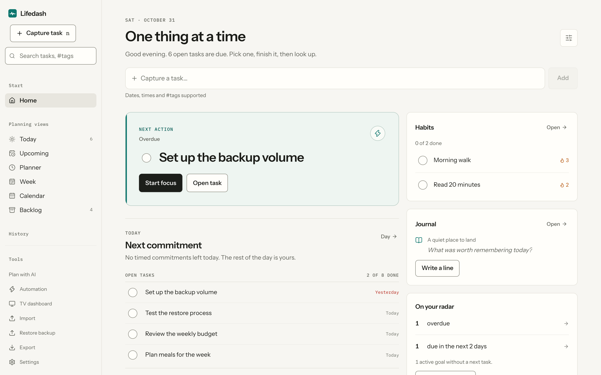
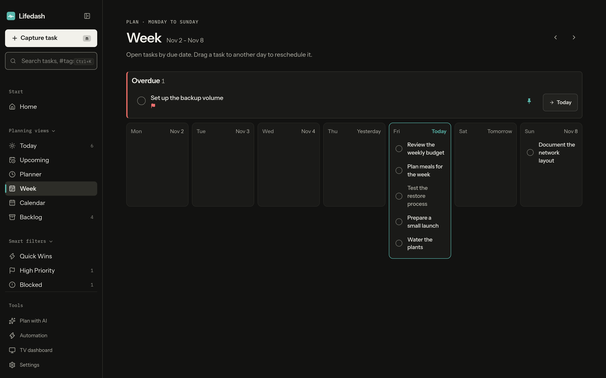
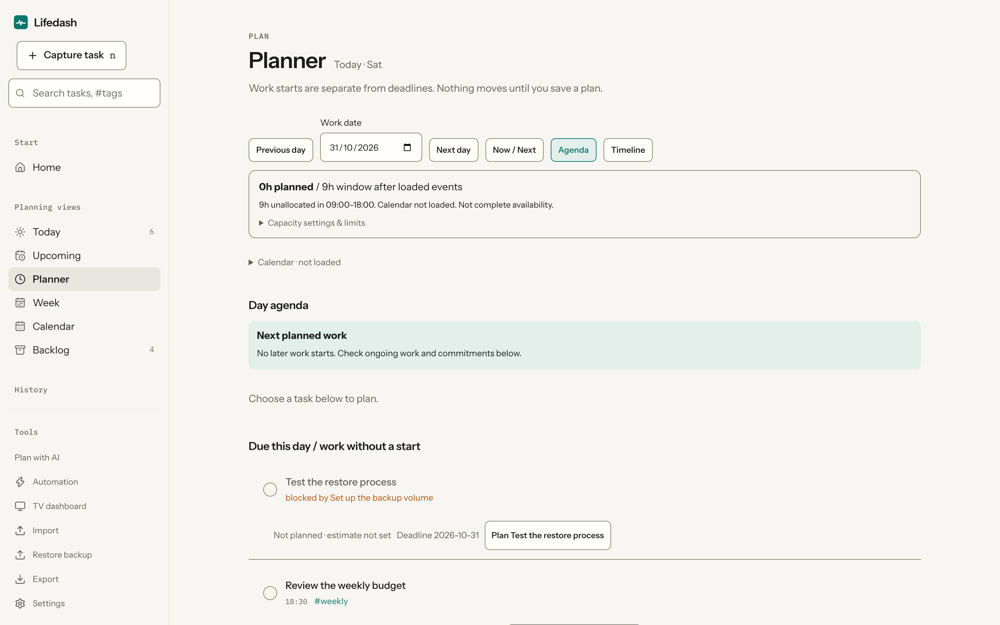
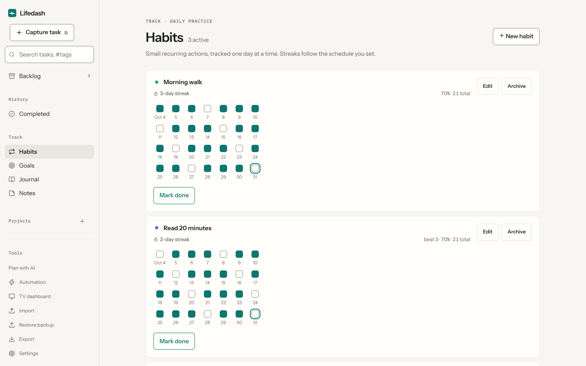
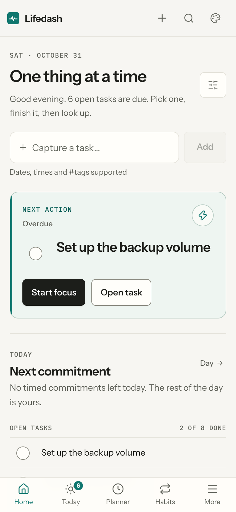

# Lifedash

**Your whole life in one calm, local-first dashboard.** Tasks, projects, habits, goals, notes, a daily reflection journal, and an hourly planner in one place. Local-first and installable as a PWA on desktop and mobile; an optional self-hosted sync server keeps your devices in step.

<p align="center">
  
</p>

<table>
  <tr>
    <td width="33.3%"></td>
    <td width="33.3%"></td>
    <td width="33.3%"></td>
  </tr>
  <tr>
    <td align="center"><sub><strong>Week view</strong> (dark mode)</sub></td>
    <td align="center"><sub><strong>Hourly planner</strong></sub></td>
    <td align="center"><sub><strong>Habits tracking</strong></sub></td>
  </tr>
</table>

<details>
<summary><strong>📱 Mobile preview</strong></summary>
<br>
<p align="center">
  
</p>
</details>

More UI captures live in [`shots/`](shots/).

---

## Why Lifedash

- **Local-first & private.** Everything lives in your browser's IndexedDB and works fully offline. No account is needed to use the app, and no personal data ever leaves your device unless you choose to sync.
- **Calm, intentional hierarchy.** "One thing at a time." The Home briefing surfaces your recommended next action and committed work without dumping an overwhelming wall of tasks in front of you.
- **Everything in one place.** Tasks, subtasks, projects, recurring habits, long-horizon goals, rich-text notes, a daily reflection journal, and an hourly planner share one coherent design system.
- **Yours to host.** The optional sync server is a lean FastAPI + SQLite service you run yourself — one Docker Compose command, no third-party cloud dependencies.
- **16 crafted visual styles.** Built on a shared semantic token architecture. Features Paper (the default editorial aesthetic), Terminal, High Contrast, Modern Dark, Luxury, Retro, and more — each with first-class light and dark modes.

---

## Features

### 🎯 Plan & Schedule
- **Home:** Daily briefing with an unblocked next action hero, scheduled commitments, and today's open tasks.
- **Planner:** Hourly day timeline with drag-and-drop time blocking or tap-to-schedule on touch devices.
- **Week & Calendar:** Seven-day view with an overdue strip, alongside an interactive month calendar with day drill-down.
- **Today & Upcoming:** Dedicated views for today's commitments and the next 14 days grouped by date.
- **Backlog:** A safe parking lot for unscheduled ideas with quick review to pull tasks into Today.

### ⚡ Capture & Tasks
- **Natural-language quick add:** Instant entry with smart parsing (e.g., `"Review budget tomorrow 6pm #finance"`).
- **Subtasks & dependencies:** Blocked-by relationships with visual alerts and cycle prevention.
- **Recurring tasks:** Full RRULE support for daily, weekly, monthly, or custom interval cadences.
- **Rich task notes:** TipTap-powered editor supporting headings, lists, links, checklists, and file attachments.
- **Priorities & tags:** Filter, pin, and organize with custom project colors and tags.

### 🌱 Habits & Goals
- **Habits:** Daily or custom weekday tracking, streak counts, completion rates, and an interactive history matrix.
- **Goals:** Set target dates, measure connected task completion, and track actionable next steps.
- **Weekly Review:** Guided flow to review past-week progress and set goals for the coming week.

### 📖 Notes & Journal
- **Daily Journal:** Reflection workspace with mood tracking, daily highlights (synced to the TV dashboard), and rich notes.
- **Notes:** Pinned notes, quick filtering, and one-click conversion from note checklists into active tasks.
- **Command Palette (`Ctrl+K` / `/`):** Global fuzzy search and instant keyboard navigation across all tasks, notes, journal entries, and views.

### 🔒 Sync & Portability
- **Self-hosted sync:** FastAPI + SQLite backend with incremental conflict-free sync and offline changes queue.
- **Import & Export:** Direct import from Todoist CSV, generic CSV, Obsidian Markdown, and Lifedash JSON; complete one-click portable backup and restore.
- **TV Dashboard:** Standalone full-screen kiosk dashboard for ambient displays.
- **Optional Local AI & MCP:** Local AI task planner with privacy-preserving inspection, and a read-only Model Context Protocol (MCP) server for offline agents.

---

## Quick Start

### One-Command Quick Start (Recommended)

Requires Node 20+ and [uv](https://docs.astral.sh/uv/) (Python 3.11+):

```bash
make quickstart
```

This verifies and installs frontend dependencies (`npm ci`) and backend dependencies (`uv sync`), then immediately boots both the frontend PWA (`http://localhost:5173`) and the sync server (`http://localhost:8787`) together.

> **Explore sample data:** Open `http://localhost:5173/?sample` to explore a fully populated, fictional sandbox that never touches your real database or sync settings.

### Individual Components

#### Frontend App

Requires Node 20+:

```bash
cd app
npm install
npm run dev        # http://localhost:5173
```

#### Optional Sync Server

Requires Python 3.11+:

With `uv` (recommended):

```bash
cd server
uv sync --all-groups
SYNC_DB=./dev.db SYNC_OPEN_REGISTRATION=1 uv run uvicorn app.main:app --port 8787 --no-proxy-headers
```

Or with `pip`:

```bash
cd server
pip install -r requirements-dev.txt
SYNC_DB=./dev.db SYNC_OPEN_REGISTRATION=1 uvicorn app.main:app --port 8787 --no-proxy-headers
```

---

## Self-Host with Docker

From the repository root:

```bash
docker compose up --build
```

- **App:** `http://localhost:8080`
- **Sync Server:** `http://localhost:8787`
- **Setup checklist:** Open `http://localhost:8080/selfhost.html` to run through first account registration, HTTPS configuration, sync limits, and backup guidelines.

Prefer a terminal walkthrough? `make setup` runs preflight checks interactively; `make setup-check` is the read-only inspection.

> [!WARNING]
> **Know before you restore:** Restoring an older server database snapshot can cause devices to miss subsequent sync changes. Always review the cautious recovery guide in [server/SELFHOST.md](server/SELFHOST.md) before rolling back server state.

---

## Documentation

- [PRODUCT.md](PRODUCT.md) — Product truth, user principles, and design philosophy
- [app/DESIGN.md](app/DESIGN.md) — Design system tokens, typography, layout rules, and accessibility standards
- [server/SELFHOST.md](server/SELFHOST.md) — Production deployment, TLS termination (Caddy, Tailscale), and backup procedures
- [docs/self-host-hardening.md](docs/self-host-hardening.md) — Security settings, proxy limits, CORS, and environment variables
- [docs/SPEC.md](docs/SPEC.md) — Complete product specification
- [docs/ARCHITECTURE.md](docs/ARCHITECTURE.md) — Technical architecture and sync protocol details
- [docs/ROADMAP.md](docs/ROADMAP.md) — Development plans and milestones

---

## Development

```bash
make quickstart    # Fast one-step setup and launch: install dependencies (if needed) & start local dev
make install       # Install frontend (npm ci) and backend dependencies (uv sync --all-groups)
make dev           # Start frontend Vite server + Python sync server together
make test          # Run frontend Vitest test suite + backend Pytest suite
make test-keyboard # Run Playwright keyboard and accessibility regressions
make build         # Compile production bundle (app/dist)
make help          # View all automation targets (Docker, smoke tests, etc.)
```

CI runs the unit test suites, keyboard checks, and production builds on every pull request and push to `main`.

---

## Project Structure

```
app/          React 18 + TypeScript + Vite PWA (Dexie, TipTap, Lucide, rrule)
server/       FastAPI + SQLite sync server (Docker, migrations, self-host suite)
mcp/          Optional read-only Model Context Protocol server for offline snapshot querying
shots/        Curated high-resolution screenshots for desktop and mobile
docs/         Specifications, architecture documentation, and hardening guides
scripts/      Setup, backup verification, and deployment helpers
```

---

## License

[MIT](LICENSE) © 2026 Lifedash contributors
