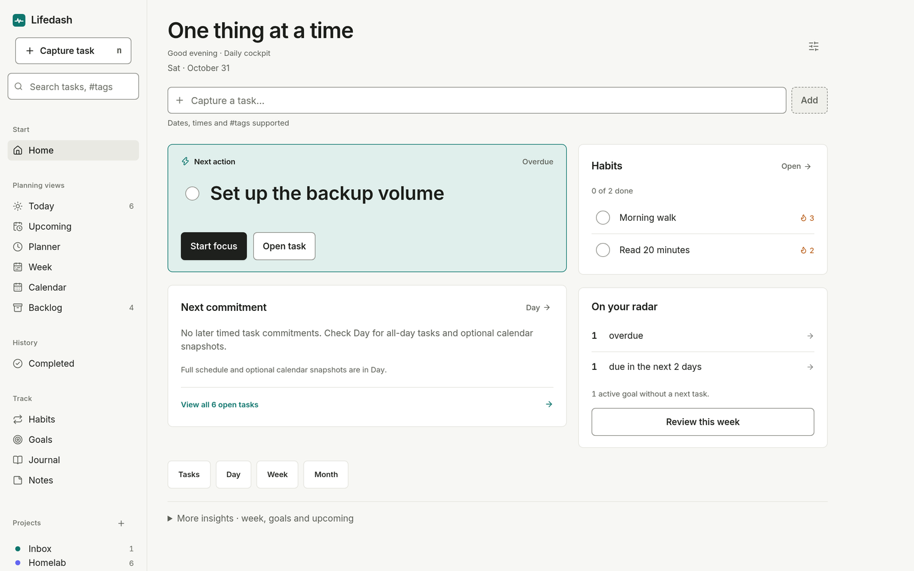
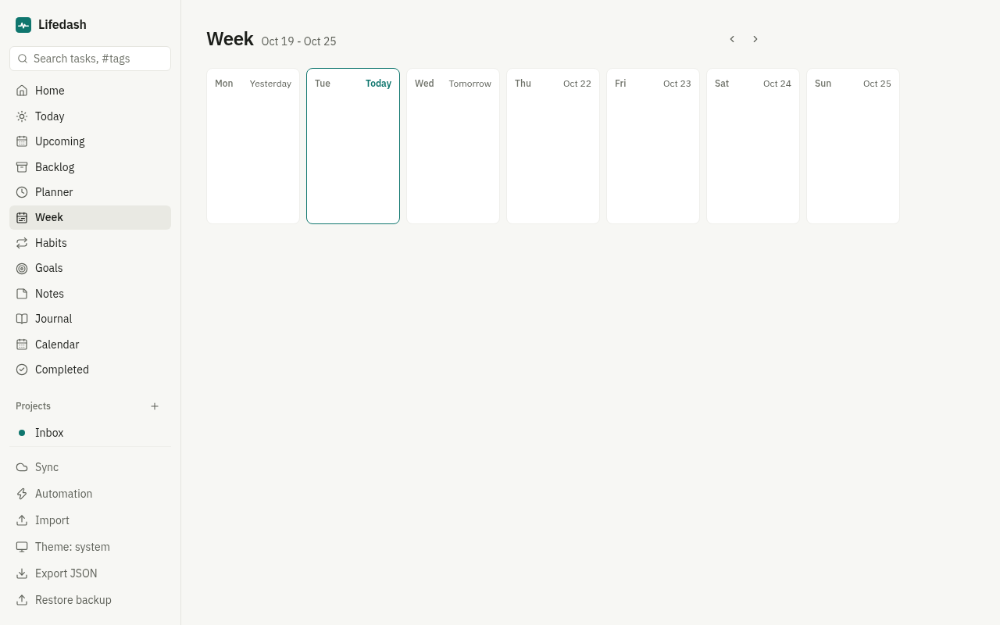
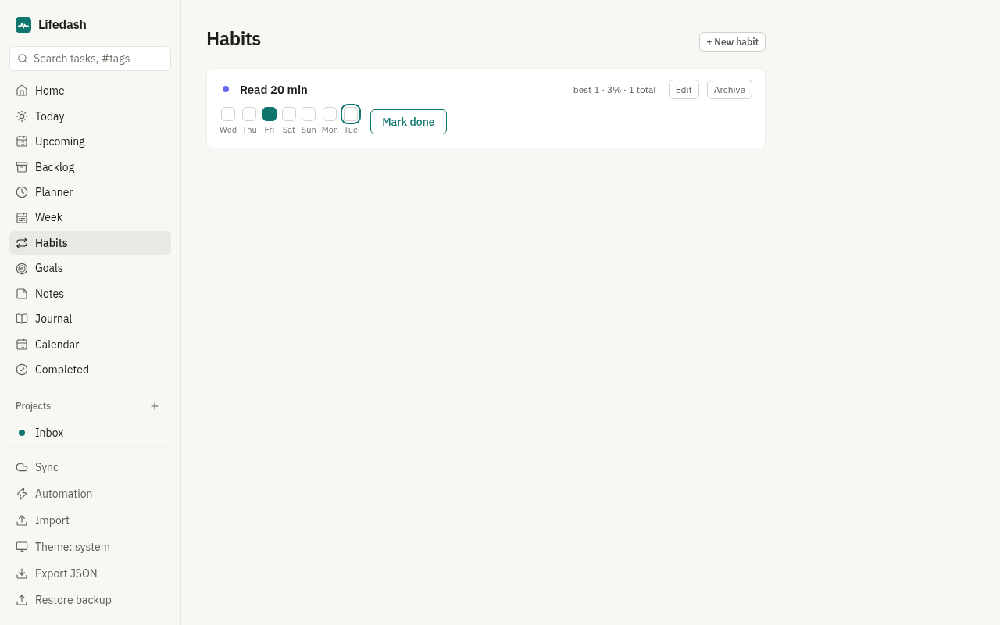
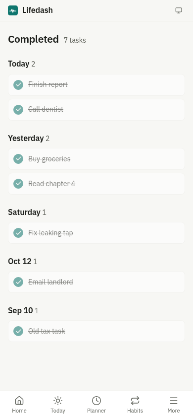

# LifeDash

A whole-life dashboard built around a centralized task app: tasks, projects,
habits, goals, notes, a journal and a day planner in one place. Local-first
and installable as a PWA on desktop and mobile; an optional self-hosted sync
server keeps devices in step.

Single user, in active development.

## Self-host

From the repository root, run `make setup` for a guided Docker Compose setup
(Python 3 and make required). It checks Docker/Compose/config, explains the
network exposure and asks before building or starting services.
`make setup-check` only runs the read-only preflight. It never starts services.
The helper pins the root Compose file (ignores `COMPOSE_FILE` and implicit
overrides), but your Docker context and `COMPOSE_PROJECT_NAME` still apply.
Confirm the intended host/project before consenting: existing services may be
recreated. Custom override stacks should use manual Compose. Its health check
runs inside the selected sync container, not an unrelated service on a host port.

Or start directly with Docker Compose:

    docker compose up --build

App on http://localhost:8080, sync server on http://localhost:8787.
Open the bundled setup checklist at `http://localhost:8080/selfhost.html`
(or use the setup-guide link in Settings). It walks through first-account setup,
HTTPS/device URLs, sync limits and backups without contacting another service.

Details and other deployment options: [server/SELFHOST.md](server/SELFHOST.md).

## Local development

Run `make install` once to install npm dependencies and a server virtual
environment, including test dependencies. Then `make dev` starts the app on
Vite's local URL and the sync server on http://127.0.0.1:8787. Ctrl-C stops
both. `make test` runs both suites; `make build` builds the frontend.
`make help` lists individual app/server and Docker targets. Python 3 with
venv support, Node/npm and make are required. Docker targets additionally
need Docker Engine and the Compose plugin.

`make test-keyboard` starts a temporary loopback Vite server and runs the
sample-only desktop/phone keyboard checks for dialogs, Appearance, the command
palette, mobile navigation and Export. It needs an installed Chrome/Chromium;
set `CHROME_PATH` if it is not `/usr/bin/google-chrome`. No real user database,
sync account or AI provider is used. The server stops when checks finish or are
interrupted. The default port is 4174; use `KEYBOARD_TEST_PORT` to choose another
free port. An occupied port fails rather than using an existing server.

`make test-selfhost` runs a disposable loopback API check for restart persistence
and SQLite online backup/restore. It uses synthetic temporary databases only.
It requires the installed server venv and a POSIX host; it does not test Docker,
TLS, a reverse proxy or real-device sync.

## Docs
## Screenshots

| Home | Week |
|---|---|
|  |  |

| Habits | Completed (mobile) |
|---|---|
|  |  |

More UI screenshots live in [`shots/`](shots/).

## Features

**Tasks**
- Create, edit, complete, reorder (drag-and-drop on desktop, long-press on touch)
- Subtasks, pinned tasks, priorities, tags, due dates and times
- Rich-text task notes (TipTap: headings, lists, links, checklists) with media attachments
- Recurring tasks (rrule: daily, weekly, monthly, every N days)
- Dependencies: blocked-by relationships with warnings and cycle prevention
- Natural-language quick add ("Call Sam tomorrow 9am #personal")

**Views**
- Home: what matters now, with a suggested next task
- Today: due today plus overdue; Upcoming: next 14 days grouped by day
- Backlog: no-date parking lot, pull tasks into Today
- Completed: grouped by completion day with counts
- Week: seven columns, overdue strip, previous/next week navigation
- Calendar: month grid with day drill-down
- Planner: hourly timeline, drag tasks into time blocks or tap to schedule on touch
- Projects with colors and per-project progress; Inbox for unsorted capture

**Beyond tasks**
- Goals: link tasks, track progress, set target dates
- Habits: daily or chosen weekdays, streaks, completion rate, week grid with per-day toggles
- Notes: rich text with pinning, filtering and one-click "checklist to tasks"
- Journal: one entry per day with mood and jump-to-date
- Global search across tasks, notes, journal and goals; command palette and keyboard shortcuts

**Data**
- Local-first: IndexedDB (Dexie); the app fully works offline
- Import from Todoist CSV, generic CSV, Obsidian Markdown and LifeDash JSON
- Export a full JSON backup and restore it
- Optional self-hosted sync (FastAPI + SQLite, see `server/`) with offline queue
- Automation rules: roll overdue tasks into Today; complete a parent when its subtasks finish
- Light, dark or system theme

## Quickstart

The app (`app/`) - needs Node 20+:

```bash
cd app
npm install
npm run dev        # http://localhost:5173
```

The sync server (`server/`, optional) - needs Python 3.11+:

```bash
cd server
pip install -r requirements-dev.txt
SYNC_DB=./dev.db SYNC_OPEN_REGISTRATION=1 uvicorn app.main:app --port 8787 --no-proxy-headers
```

Or with Docker: `cd server && docker compose up -d --build`.

## Tests

```bash
cd app && npm test          # 86 unit tests (Vitest)
cd app && npm run build     # type-check (tsc) + production build
cd server && pytest         # 15 tests
```

CI runs both suites on every push to `main` and every PR
(`.github/workflows/ci.yml`).

## Configuration

The app needs no configuration. To enable sync, open the Sync dialog in the
app and point it at your server URL and account.

Server environment variables:

| Variable | Default | Purpose |
|---|---|---|
| `SYNC_DB` | `./lifedash.db` | SQLite database path |
| `SYNC_OPEN_REGISTRATION` | unset | `1` keeps account registration open; otherwise it closes after the first user |

## Deploy

- **App:** `cd app && npm run build` produces a static `dist/` you can host
  anywhere. Serve over HTTPS for install prompts and the service worker.
- **Server:** Docker (see above) or a bare-metal Python process behind a TLS
  reverse proxy. Full guide: [`server/SELFHOST.md`](server/SELFHOST.md).

## Project structure

```
app/      React + TypeScript + Vite PWA (Dexie, TipTap, rrule)
server/   FastAPI + SQLite sync server (Dockerfile, compose, self-host guide)
docs/     SPEC.md, ROADMAP.md, ARCHITECTURE.md
shots/    real-browser screenshots referenced by PRs
```

## License

Not yet chosen.

## Fictional development data

Run `cd app && npm run dev`, then open `/?sample`. Development builds use a separate `lifedash-sample` IndexedDB database, seeded once with fictional tasks, projects, notes, goals, habits and journal entries. An amber banner marks the sandbox. Exit by removing `?sample`; the real `lifedash` database stays separate. Delete only `lifedash-sample` in browser storage to reset it.

Sample mode cannot read or change the saved real sync account, authenticate, revoke its token, or start manual/automatic sync. It does not block unrelated network features such as AI tools, so use only fictional content. Production builds ignore `?sample`.
